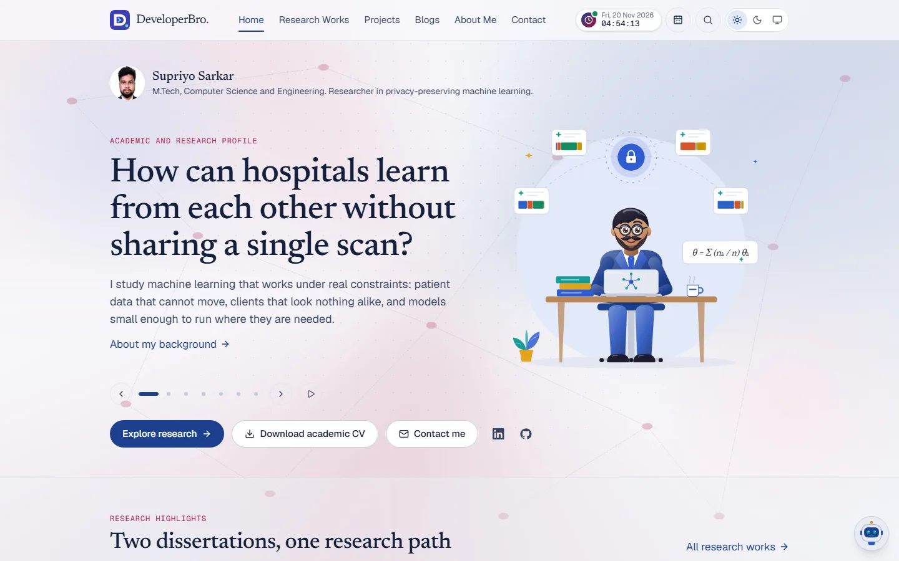
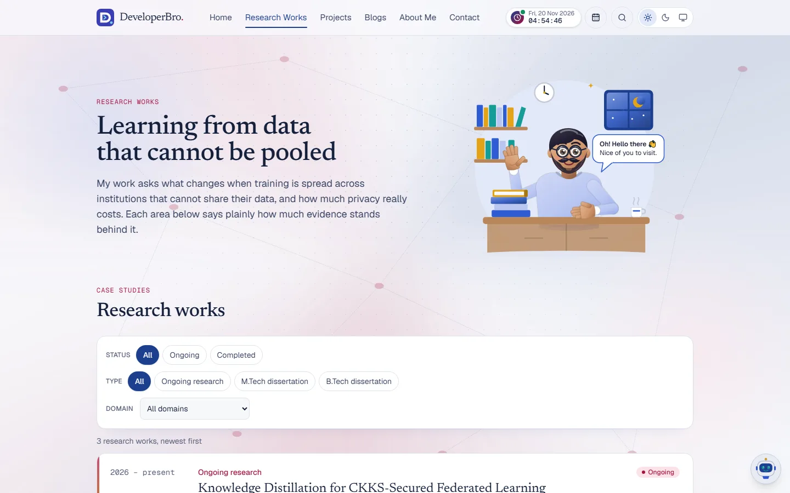
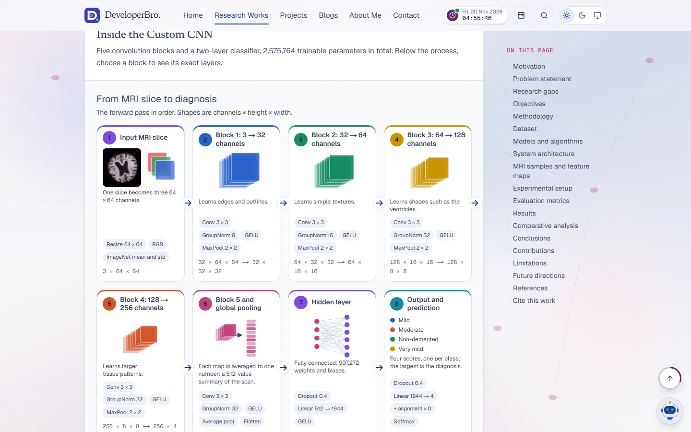
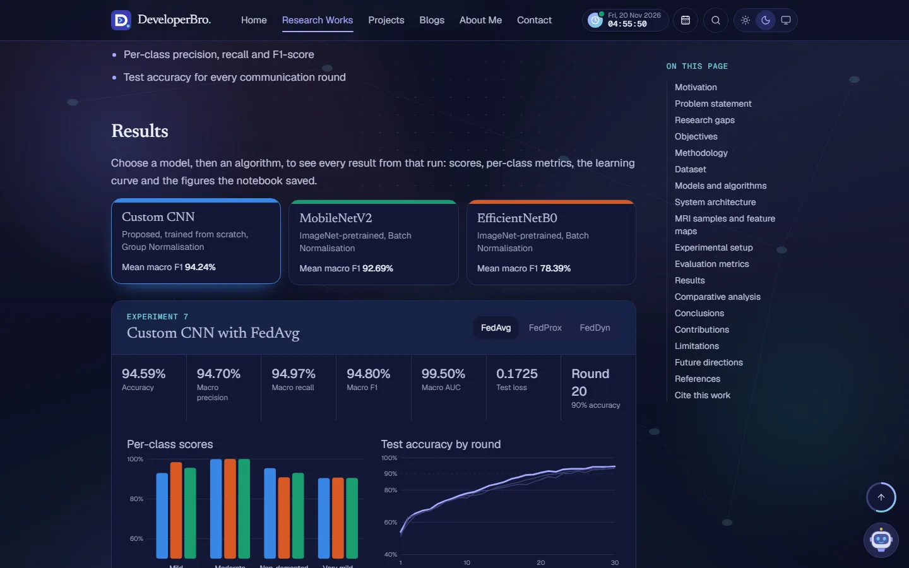
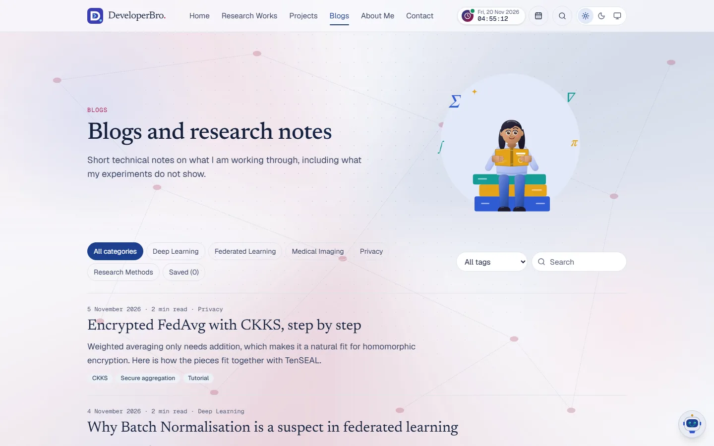
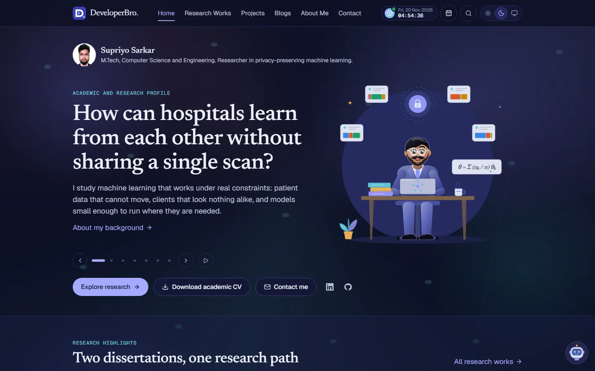
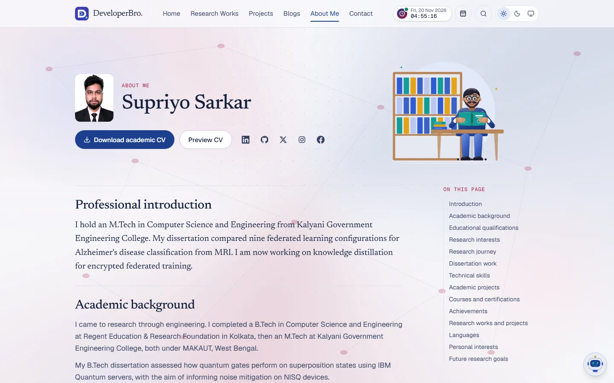

<!-- DeveloperBro. academic portfolio README -->

<div align="center">

<a href="https://developerbro.vercel.app"></a>

# Supriyo Sarkar

**Academic portfolio · Computer Science & Engineering**

<a href="https://developerbro.vercel.app"></a>
<a href="https://github.com/Supriyo016"></a>
<a href="mailto:supriyo.sarkar016@gmail.com"></a>


* A research-first portfolio built to make technical work easier to explore, verify and discuss. *

</div>

---

## ✨ Overview

**DeveloperBro.** is the academic and research portfolio of **Supriyo Sarkar**, an M.Tech graduate in Computer Science and Engineering from Kalyani Government Engineering College.

The portfolio brings together research case studies, technical notes, projects, academic background and contact information. Its central theme is **privacy-preserving and federated machine learning**, with related work in medical image analysis, deep learning, homomorphic encryption and quantum computing.

It is designed for prospective research supervisors, PhD selection committees, collaborators and developers who want to explore the work behind the profile—not just read a short biography.

> **Research principle:** A result should be presented with its experimental setup, evidence and limitations. The website follows the same principle throughout its case studies.

<div align="center">
<a href="https://developerbro.vercel.app"></a>
<br /><sub>Homepage · Light theme · <a href="https://developerbro.vercel.app">Open the live portfolio ↗</a></sub>
</div>

## 🧭 Explore the portfolio

| Area | What it contains |
|---|---|
| **Home** | Profile, research direction, featured work and academic timeline |
| **Research Works** | Case studies, evidence labels, methodology, results, figures and references |
| **Projects** | Searchable project catalogue with technology and category filters |
| **Blogs** | Technical notes with mathematical notation, code highlighting, charts and references |
| **Publications** | Publication records with their stated status; work in progress is not presented as published |
| **About Me** | Academic background, research direction and personal profile |
| **Education & Skills** | Academic timeline, technical skills, achievements and courses |
| **Academic CV** | CV web page and downloadable PDF |
| **Contact** | Contact form and social links |
| **GitHub** | Repository activity and public GitHub information |

## 🔬 Research at a glance

The research section is organised as case studies rather than a flat list of titles. Each study provides its background, research questions, methodology, experimental setup, findings and limitations.

### Federated learning for Alzheimer's MRI classification

A comparative study of three CNN backbones and three federated optimisation algorithms under a simulated non-IID client split. The work includes a CKKS encryption prototype and discusses what was—and was not—encrypted in the reported experiments.

- **Methods:** FedAvg, FedProx, FedDyn, Dirichlet partitioning and CKKS
- **Models:** Custom CNN, MobileNetV2 and EfficientNetB0
- **Focus:** medical image classification, privacy and heterogeneous data

### Quantum gate performance on IBM Quantum

A B.Tech dissertation studying quantum gate behaviour on superposition states using IBM Quantum hardware, with attention to gate performance and noise mitigation.

### Ongoing direction

Current research development explores **knowledge distillation for CKKS-secured federated learning**. It is marked as work in progress; preliminary development work is not presented as a completed publication.

<div align="center">

<br /><sub>Research Works · Case-study explorer</sub>
</div>

<details>
<summary><strong>Open selected research visuals</strong></summary>
<br />
<table>
<tr>
<td width="50%"><p align="center"><sub>M.Tech dissertation case study</sub></p></td>
<td width="50%"><p align="center"><sub>Custom CNN · Model explanation</sub></p></td>
</tr>
<tr>
<td width="50%"><p align="center"><sub>Model comparison explorer</sub></p></td>
<td width="50%"><p align="center"><sub>Quantum computing case study</sub></p></td>
</tr>
</table>
</details>

**Important context:** reported model metrics belong to the specified experimental dataset and protocol. They are not clinical validation, medical advice or evidence of deployment in hospitals.

## 🛠️ Projects

The portfolio contains project details, implementation notes, technology stacks and repository links.

| Project | Area | Description |
|---|---|---|
| [Tour India](https://github.com/Supriyo016/TourIndia) | Web development | Travel discovery and planning experience covering Indian states, Union Territories and destination guides |
| [Third Hand-Eye](https://github.com/Supriyo016/Arduino-Uno-Third-Hand-Eye-Project-for-Visually-Impaired-Individuals) | Embedded systems | Arduino Uno prototype using an ultrasonic sensor and audible obstacle alerts |
| [DeveloperBro.](https://github.com/Supriyo016/DeveloperBro-Academic-Portfolio) | Web development | This research-focused academic portfolio |

## 📝 Research notes and technical writing

The blog area is designed for technical reading rather than short promotional posts. Articles can include:

- Mathematical expressions rendered with **KaTeX**
- Syntax-highlighted code blocks powered by **Shiki**
- Charts, diagrams, references and related research links
- Reading progress and a focused reading experience
- RSS feed: [/feed.xml](https://developerbro.vercel.app/feed.xml)

<div align="center">

<br /><sub>Blogs · Research notes and technical explanations</sub>
</div>

## 🎨 Interface and experience

The visual design aims to support reading and exploration without overwhelming the academic content.

- **Light and dark themes** with theme-aware components and illustrations
- **CSS-based motion** using transforms and opacity, with reduced-motion support
- **Pause-animation control** for visitors who prefer a still interface
- **Hand-built SVG illustrations** that adapt to the active theme
- **Interactive research views** including model explorers, diagrams, comparison charts and quantum circuit visuals
- **Responsive layouts** for desktop, tablet and mobile
- **Search and filters** across research, projects and writing
- **Accessibility-minded components**, keyboard support and contrast-aware chart alternatives
- **SEO foundations** including page metadata, sitemap, robots rules and structured profile data

<div align="center">
<table>
<tr>
<td width="50%"><p align="center"><sub>Dark theme</sub></p></td>
<td width="50%"><p align="center"><sub>About Me</sub></p></td>
</tr>
<tr>
<td colspan="2" align="center"><br /><sub>Mobile layout</sub></td>
</tr>
</table>
</div>

## 🧱 Technology stack

<div align="center">

</div>

| Layer | Technologies |
|---|---|
| Framework | Next.js 16 · React 19 · App Router |
| Language | TypeScript |
| Styling | Tailwind CSS 4 · CSS variables |
| Content | Typed TypeScript data · MDX |
| Mathematics & code | KaTeX · Shiki |
| Validation | Zod |
| Email delivery | Resend |
| Testing | Vitest · Playwright · axe |
| Quality | ESLint · TypeScript checks · npm audit |
| Hosting | Vercel |
| Automation | GitHub Actions · Dependabot |

### Architecture choices

- Server Components are the default; client-side JavaScript is reserved for interactive features.
- Research and profile content lives in version-controlled typed files and MDX.
- **There is no database** because the current portfolio does not need one.
- Animations use CSS rather than a large motion framework.
- A per-request nonce-based Content Security Policy and security headers help reduce injection risks.
- The contact endpoint validates input and applies origin, token and rate-limit checks.

See [Architecture](docs/ARCHITECTURE.md) for the design decisions and trade-offs.

## 🗺️ Application structure

```text
DeveloperBro-Academic-Portfolio/
├── .github/
│   ├── workflows/
│   │   └── ci.yml
│   └── dependabot.yml
├── docs/
│   ├── screenshots/
│   ├── ARCHITECTURE.md
│   ├── CONTENT_SOURCES.md
│   ├── DEPLOYMENT.md
│   ├── DEVELOPMENT_GUIDE.md
│   ├── SECURITY.md
│   └── TESTING.md
├── public/
│   ├── documents/
│   └── images/
├── src/
│   ├── app/             # App Router pages, metadata and API routes
│   ├── components/      # Feature UI, SVG illustrations and primitives
│   ├── content/         # Typed profile, project, research and article data
│   ├── hooks/           # Shared client hooks
│   ├── lib/             # Content, search, security and utilities
│   ├── services/        # External service integration
│   ├── types/           # Shared TypeScript types
│   └── proxy.ts          # Request proxy and security headers
├── tests/
│   ├── e2e/
│   ├── integration/
│   ├── security/
│   └── unit/
├── package.json
└── README.md
```

### Main routes

| Route | Purpose |
|---|---|
| `/` | Home |
| `/research` | Research overview and case studies |
| `/projects` | Project catalogue |
| `/blogs` | Research notes |
| `/publications` | Publication status |
| `/about` | Profile and research direction |
| `/education` | Academic timeline |
| `/skills` | Technical skills |
| `/achievements` | Achievements and courses |
| `/cv` | Academic CV |
| `/contact` | Contact form |
| `/github` | GitHub information |

## 🚀 Run locally

### Prerequisites

- **Node.js 20.9 or later**
- npm
- Git

### 1. Clone the repository

```bash
git clone https://github.com/Supriyo016/DeveloperBro-Academic-Portfolio.git
cd DeveloperBro-Academic-Portfolio
```

### 2. Install dependencies

```bash
npm install
npx playwright install chromium
```

### 3. Configure environment variables

Create a local environment file:

```bash
cp .env.example .env.local
```

PowerShell equivalent:

```powershell
Copy-Item .env.example .env.local
```

Set the public site URL and configure the contact service only when you need contact-form delivery.

| Variable | Required | Description |
|---|---:|---|
| `NEXT_PUBLIC_SITE_URL` | Yes for production | Canonical site URL and sitemap origin |
| `RESEND_API_KEY` | For email delivery | Resend API key |
| `CONTACT_TO_EMAIL` | Optional | Destination for contact messages |
| `CONTACT_FROM_EMAIL` | Optional | Verified sender address |
| `CONTACT_FORM_SECRET` | Optional | Secret used to sign contact-form tokens |
| `GITHUB_TOKEN` | Optional | Raises GitHub API rate limits; use a fine-grained token with minimal permissions |

**Never commit `.env.local`, API keys, tokens or private documents.**

### 4. Start the development server

```bash
npm run dev
```

Open [http://localhost:3000](http://localhost:3000).

## 🧪 Quality checks

Run the checks before submitting changes:

```bash
npm run lint
npm run typecheck
npm test
npm run build
```

Browser tests:

```bash
npx playwright install chromium
npm run test:e2e
```

The GitHub Actions workflow runs dependency installation, production dependency audit, TypeScript checks, ESLint, Vitest and a production build on pushes and pull requests.

| Script | What it does |
|---|---|
| `npm run dev` | Start local development |
| `npm run build` | Create production build |
| `npm run start` | Start production server |
| `npm run lint` | Run ESLint |
| `npm run typecheck` | Run TypeScript without emitting files |
| `npm test` | Run unit, integration and security tests |
| `npm run test:e2e` | Run Playwright browser tests |
| `npm run audit:deps` | Audit production dependencies |

For the test strategy and coverage boundaries, see [Testing](docs/TESTING.md).

## ☁️ Deployment

The production site is hosted on **Vercel**:

**[https://developerbro.vercel.app](https://developerbro.vercel.app)**

The repository is connected to Vercel. Pushes to `main` trigger production deployment; other branches can be used for preview deployments.

For manual deployment and production environment setup, read [Deployment](docs/DEPLOYMENT.md).

## 🔐 Security and privacy

Security is treated as part of the implementation, not as a badge or marketing claim.

- Security headers and nonce-based Content Security Policy
- Server-side input validation for the contact endpoint
- Same-origin checks, signed form tokens and rate limiting
- Secret values are kept in deployment environment settings
- No analytics or advertising cookies are used by the current site
- Private source material and original working documents are excluded from the public repository

Read [Security](docs/SECURITY.md) and [Content Sources](docs/CONTENT_SOURCES.md) for details.

## 📚 Project documentation

| Document | Details |
|---|---|
| [Architecture](docs/ARCHITECTURE.md) | Application structure, rendering strategy and technical decisions |
| [Development Guide](docs/DEVELOPMENT_GUIDE.md) | Setup, scripts and how to update portfolio content |
| [Deployment](docs/DEPLOYMENT.md) | Vercel deployment and environment configuration |
| [Testing](docs/TESTING.md) | Test types, quality checks and browser coverage |
| [Security](docs/SECURITY.md) | Security controls and known boundaries |
| [Content Sources](docs/CONTENT_SOURCES.md) | Evidence and sources behind portfolio claims |

## 🤝 Contributions and feedback

This is a personal academic portfolio, so its research content and identity are maintained by the owner. Technical feedback, accessibility suggestions and bug reports are welcome through GitHub Issues.

Please do not submit changes that invent academic results, publication status, credentials or project capabilities.

## 📬 Connect

<div align="center">

<a href="mailto:supriyo.sarkar016@gmail.com"></a>
<a href="https://www.linkedin.com/in/supriyo-sarkar/"></a>
<a href="https://github.com/Supriyo016"></a>
<a href="https://x.com/Supriyo016"></a>

**Open to doctoral research opportunities and academic collaboration.**

<a href="https://developerbro.vercel.app/contact">Contact through the portfolio ↗</a>

</div>

---

<div align="center">
<sub>Built with care by <a href="https://github.com/Supriyo016">Supriyo Sarkar</a> · Copyright © 2026 · See <a href="LICENSE">LICENSE</a></sub>
<br />

</div>
