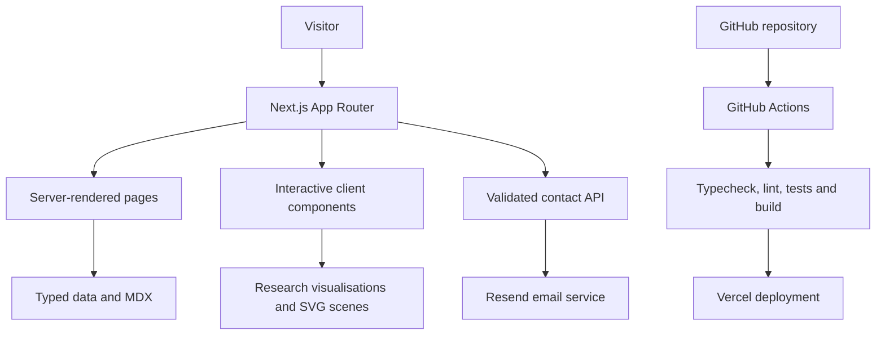

<!-- DeveloperBro. | Academic portfolio of Supriyo Sarkar -->

<div align="center">

<a href="https://developerbro.vercel.app"></a>

# Supriyo Sarkar

**Computer Science & Engineering · Research · Software Development**

<a href="https://developerbro.vercel.app"></a>
<a href="https://github.com/Supriyo016"></a>
<a href="mailto:supriyo.sarkar016@gmail.com"></a>

<p>


</p>

*An evidence-led academic portfolio — built to communicate research, show implementation details and make technical work easier to evaluate.*

</div>

---

## ✨ About

I am **Supriyo Sarkar**, an M.Tech graduate in Computer Science and Engineering from **Kalyani Government Engineering College**. My interests span machine learning, deep learning, privacy-preserving computation, medical image analysis, quantum computing and full-stack development.

My academic work has explored how machine learning can be trained across distributed data holders, how privacy mechanisms affect model workflows, and how experimental protocols shape reported results. Alongside research, I build practical software and embedded-system projects.

- 🎓 **M.Tech, Computer Science & Engineering** — Kalyani Government Engineering College (2024–2026)
- 🎓 **B.Tech, Computer Science & Engineering** — Regent Education & Research Foundation (2020–2024)
- 🔬 Research interests: Federated Learning, Privacy-Preserving ML, Medical Image Analysis, Deep Learning and Knowledge Distillation
- 🧩 Engineering interests: Web Applications, Data Science, Embedded Systems and Developer Tooling
- 🤝 Open to doctoral research opportunities and meaningful academic collaboration

<div align="center">

<br><sub>DeveloperBro. · Academic portfolio homepage</sub>
</div>

## 🔬 Research focus

The portfolio presents research as detailed case studies, including research questions, data protocol, methodology, experiment design, results, references and limitations.

### Privacy-preserving Alzheimer's disease detection from MRI

M.Tech dissertation comparing convolutional backbones and federated optimisation methods for four-class Alzheimer's MRI classification under simulated non-IID client data.

- **Backbones:** Custom CNN, MobileNetV2 and EfficientNetB0
- **Federated algorithms:** FedAvg, FedProx and FedDyn
- **Privacy component:** CKKS Fully Homomorphic Encryption prototype using TenSEAL
- **Evaluation:** held-out test results, macro metrics, class-wise performance and comparison across configurations

### Quantum gate performance on superposition states

B.Tech dissertation work exploring quantum gate behaviour on IBM Quantum hardware, with an emphasis on gate performance and noise-related effects.

### Current research direction

Ongoing development explores **knowledge distillation for CKKS-secured federated learning**. This is presented as work in progress, not as a completed publication.

> [!IMPORTANT]
> Research results shown on the website belong to their stated datasets and experimental protocols. They are not clinical validation, medical advice or proof of hospital deployment. The portfolio distinguishes completed work, ongoing work and proposed directions.

<div align="center">

<br><sub>Research case study · Federated learning dissertation</sub>
</div>

## 🧑‍💻 About this portfolio

**DeveloperBro.** is the portfolio website documented by this repository. It brings together academic background, research case studies, software development work, technical writing and contact information in one place.

The site is designed to make technical work easier to explore and evaluate through:

- Research case studies with methodology, experiment design, metrics, references and limitations.
- Project pages that explain the problem, implementation choices and technology stack.
- Technical notes with mathematical notation, code examples and supporting references.
- Responsive layouts, theme controls, SVG illustrations and reduced-motion support.
- A validated contact form and clear links to academic and professional profiles.

## 📝 Research notes and writing

Technical articles and research notes cover topics such as federated learning, homomorphic encryption, deep learning, model evaluation and related computer-science concepts.

- Mathematical expressions rendered with **KaTeX**
- Syntax-highlighted code through **Shiki**
- Charts, diagrams, citations and further reading
- RSS feed: [developerbro.vercel.app/feed.xml](https://developerbro.vercel.app/feed.xml)

Research notes include mathematical expressions, syntax-highlighted code, diagrams, citations and further reading. The RSS feed is available at [developerbro.vercel.app/feed.xml](https://developerbro.vercel.app/feed.xml).

## 🎨 Interface and experience

- Light, dark and theme-aware UI
- Hand-built SVG scenes and illustrations
- CSS-based motion with reduced-motion support
- Animation pause control
- Interactive research diagrams, model explorers and comparison visualisations
- Responsive layouts and keyboard-conscious interactions
- Search and filters across work and writing
- Metadata, sitemap, robots rules and structured profile data

<div align="center">

<br><sub>Responsive mobile experience</sub>
</div>

## 🧰 Technology

<div align="center">

</div>

| Focus | Tools and technologies |
|---|---|
| Programming | Python · C · C++ · JavaScript · TypeScript |
| Machine Learning | PyTorch · TensorFlow · Keras · scikit-learn · OpenCV |
| Web | Next.js · React · Node.js · Tailwind CSS |
| Data | NumPy · Pandas · Matplotlib |
| Storage | MongoDB · MySQL · PostgreSQL |
| Research tooling | Flower · TenSEAL · IBM Quantum tooling |
| Engineering | Git · GitHub · Arduino · VS Code |

### Website implementation

Next.js 16, React 19, TypeScript, Tailwind CSS 4, MDX, KaTeX, Shiki, Zod, Resend, Vitest, Playwright and Vercel.

**Architecture notes:** server components are the default, portfolio content is maintained in typed data and MDX, and no database is used because the current website does not require one. Motion is implemented with CSS rather than a heavy animation runtime.

## 🏛️ Website architecture



## 💻 Run locally

### Prerequisites

- Node.js 20.9 or later
- npm and Git

### Setup

```bash
git clone https://github.com/Supriyo016/DeveloperBro-Academic-Portfolio.git
cd DeveloperBro-Academic-Portfolio
npm install
npx playwright install chromium
cp .env.example .env.local
npm run dev
```

Open [http://localhost:3000](http://localhost:3000).

For the environment-variable reference and contact-form configuration, see [`.env.example`](.env.example) and [Deployment](docs/DEPLOYMENT.md).

### Quality checks

```bash
npm run lint
npm run typecheck
npm test
npm run build
npm run test:e2e
```

| Command | Purpose |
|---|---|
| `npm run dev` | Development server |
| `npm run lint` | ESLint |
| `npm run typecheck` | TypeScript validation |
| `npm test` | Unit, integration and security tests |
| `npm run test:e2e` | Playwright browser tests |
| `npm run build` | Production build |

## 📚 Project documentation

| Guide | Description |
|---|---|
| [Architecture](docs/ARCHITECTURE.md) | Rendering approach and technical decisions |
| [Development Guide](docs/DEVELOPMENT_GUIDE.md) | Local setup and content editing |
| [Deployment](docs/DEPLOYMENT.md) | Vercel and environment settings |
| [Testing](docs/TESTING.md) | Test strategy and browser coverage |
| [Security](docs/SECURITY.md) | Security controls and limitations |
| [Content Sources](docs/CONTENT_SOURCES.md) | Sources behind factual claims |

## 🤝 Feedback and collaboration

This is a personal academic portfolio. Corrections, technical feedback, accessibility suggestions and thoughtful discussion are welcome. Academic claims, results and publication status must remain verifiable.

## 📬 Connect

<div align="center">
<a href="https://www.linkedin.com/in/supriyo-sarkar/"></a>
<a href="https://github.com/Supriyo016"></a>
<a href="https://x.com/Supriyo016"></a>
<a href="mailto:supriyo.sarkar016@gmail.com"></a>

**Open to doctoral research opportunities and academic collaboration.**

<a href="https://developerbro.vercel.app/contact">Contact through DeveloperBro ↗</a>
</div>

---

<div align="center">
<sub>Copyright © 2026 Supriyo Sarkar · See <a href="LICENSE">LICENSE</a></sub>
<br><br>

</div>
