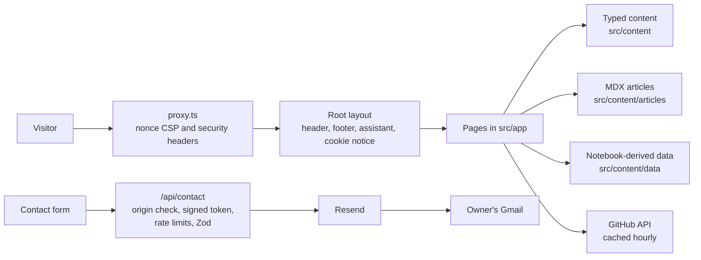

# DeveloperBro. Academic portfolio of Supriyo Sarkar

[](https://github.com/Supriyo016/DeveloperBro-Academic-Portfolio/actions/workflows/ci.yml)
[](https://developerbro.vercel.app)
[](LICENSE)

**Live: https://developerbro.vercel.app**

The research portfolio of Supriyo Sarkar, an M.Tech graduate in Computer Science and Engineering working on
privacy-preserving and federated machine learning. It is written for PhD admissions committees and research
supervisors, so every result on it can be traced to a notebook output, a thesis table or a cited paper.

> **All rights reserved.** The code is public so that it can be read and reviewed, not reused. See [License](#license).

## Contents

- [What is on the site](#what-is-on-the-site)
- [Research at a glance](#research-at-a-glance)
- [Technology](#technology)
- [Architecture](#architecture)
- [Project structure](#project-structure)
- [Getting started](#getting-started)
- [Working with content](#working-with-content)
- [Quality: tests, CI and branch protection](#quality-tests-ci-and-branch-protection)
- [Security](#security)
- [Accessibility and motion](#accessibility-and-motion)
- [Deployment](#deployment)
- [Documentation](#documentation)
- [References](#references)
- [License](#license)

## What is on the site

| Area | What it offers |
| --- | --- |
| **Research Works** | Three case studies, newest first, with filters by status, type and domain |
| **M.Tech case study** | Federated learning architecture map, the full Custom CNN from input to diagnosis, MRI samples and feature maps, a per-model results explorer, comparisons and conclusions |
| **B.Tech case study** | Quantum gate experiments on IBM hardware: circuit lab, truth tables, simulator vs hardware vs error-mitigated results, and the original figures |
| **Research notes** | 29 MDX articles with LaTeX maths, highlighted code, charts, flow diagrams and references |
| **Projects** | Third Hand-Eye (Arduino), Tour India and this portfolio |
| **About Me and CV** | Education, regrouped technical skills, verified courses with credit points and certificate links, and the CV as PDF |
| **Bro, the assistant** | A rule-based chat assistant that runs in the browser and answers only from the site's own content, with no external AI service |
| **Interface** | Animated cartoon scenes, a 28-second researcher story, page transitions, loaders, a live clock with calendar, light and dark themes |

## Research at a glance

**Privacy-Preserving Alzheimer's Disease Detection for Non-IID MRI Data: A Comparative Analysis of Federated Learning
Algorithms under Homomorphic Encryption** (M.Tech dissertation, 2024 to 2026)

- Three CNN backbones (Custom CNN, MobileNetV2, EfficientNetB0) crossed with three federated algorithms (FedAvg, FedProx,
  FedDyn), on five non-IID clients from a Dirichlet split (α = 0.5) of 35,200 MRI images.
- Best configuration: Custom CNN with Group Normalisation and FedAvg, with 94.59% accuracy, 94.80% macro F1 and 99.50%
  macro AUC on 8,800 held-out images.
- The site states what the notebooks show: training used plaintext aggregation in Flower, and CKKS encryption was
  prototyped on sampled weights. Single runs on a pre-augmented dataset, so the limitations are listed with the results.

**Knowledge Distillation for CKKS-Secured Federated Learning** (ongoing). A ResNet18 teacher and a lightweight student
inside a federated system whose aggregation runs on CKKS ciphertexts. No results are published until the work is complete.

**Quantum Gate Performance Assessment in the Presence of Superposition State using IBMQ Server** (B.Tech dissertation,
team of five). CSWAP, Peres and CCNOT gates on ibm_perth, ibm_lagos and ibmq_quito, with measurement-error mitigation.

## Technology

| Layer | Choice | Why |
| --- | --- | --- |
| Framework | [Next.js 16](https://nextjs.org/docs) App Router, [React 19](https://react.dev) | Server components by default, per-request rendering for the CSP nonce |
| Language | [TypeScript](https://www.typescriptlang.org/docs/) in strict mode | Typed content files catch broken data at build time |
| Styling | [Tailwind CSS 4](https://tailwindcss.com/docs) with CSS variables | One set of design tokens for light and dark themes |
| Writing | [MDX](https://mdxjs.com/docs/) via [next-mdx-remote](https://github.com/hashicorp/next-mdx-remote), [KaTeX](https://katex.org/docs/), [Shiki](https://shiki.style) | Maths and highlighted code in research notes, with JavaScript in MDX blocked |
| Validation | [Zod](https://zod.dev) | Front matter, contact form and GitHub API responses |
| Email | [Resend](https://resend.com/docs) | Contact form delivery |
| Testing | [Vitest](https://vitest.dev), [Playwright](https://playwright.dev/docs/intro), [axe-core](https://github.com/dequelabs/axe-core) | Unit, integration, security, browser and accessibility tests |
| Hosting | [Vercel](https://vercel.com/docs) | Git-connected deployments from `main` |

There is no database and no animation library. Illustrations are hand-written SVG animated with CSS.

## Architecture



- **Content is data.** Research, projects, skills, courses and the assistant's knowledge are typed TypeScript or JSON
  files, so updating the site rarely means touching a component.
- **Figures come from the source.** Results JSON and images are exported from the saved thesis notebooks by scripts
  kept in the git-ignored `private/` folder, never typed by hand.
- **Client code only where needed.** Interactive charts, filters, the assistant and the calendar are client components;
  everything else renders on the server.

More detail: [docs/ARCHITECTURE.md](docs/ARCHITECTURE.md).

## Project structure

```text
src/
  app/                 Routes (App Router), global styles, robots, sitemap, RSS feed, OG image
    api/contact/       Contact form endpoint
  components/          UI by feature: research, illustrations, layout, assistant, blogs, cv, ...
  content/             Typed site content, MDX articles and notebook-derived data
  hooks/               Small React hooks
  lib/                 Pure helpers: security, validation, consent, MDX, search, theme, assistant engine
  services/            Server-only integrations: email (Resend) and GitHub
  types/               Shared TypeScript types
  proxy.ts             Per-request CSP nonce and security headers
public/                Images, figures and the CV PDF
scripts/               Repository checks, such as compiling every MDX article
tests/                 unit, integration, security and e2e (Playwright) suites
docs/                  Architecture, content sources, security, deployment and testing notes
```

## Getting started

Requires [Node.js](https://nodejs.org) 20.9 or later.

```bash
npm install
cp .env.example .env.local
npm run dev
```

The site runs with an empty `.env.local`. Without an email key the contact form says it is unavailable and offers the
email link instead.

| Variable | Required | Purpose |
| --- | --- | --- |
| `NEXT_PUBLIC_SITE_URL` | No | Canonical URL; falls back to the Vercel production URL |
| `RESEND_API_KEY` | For the contact form | Sends messages to the owner's Gmail |
| `CONTACT_TO_EMAIL`, `CONTACT_FROM_EMAIL` | No | Override the default recipient and sender |
| `CONTACT_FORM_SECRET` | No | Signs the contact form token; falls back to `RESEND_API_KEY` |
| `GITHUB_TOKEN` | No | Raises the GitHub API limit from 60 to 5,000 requests an hour |

### Commands

| Command | Purpose |
| --- | --- |
| `npm run dev` | Development server |
| `npm run build` / `npm start` | Production build and server |
| `npm run typecheck` | TypeScript |
| `npm run lint` | ESLint |
| `npm test` | Unit, integration and security tests (Vitest) |
| `npm run test:e2e` | Browser tests against a production build (run `npx playwright install chromium` once, then `npm run build`) |
| `npm run audit:deps` | Production dependency audit |
| `node scripts/check-mdx.mjs` | Compile every article and flag unknown components |

## Working with content

| To change | Edit |
| --- | --- |
| Research case studies | `src/content/research.ts` |
| Model results and figures | `src/content/data/*` (regenerated from notebooks, not edited by hand) |
| A research note | Add `src/content/articles/<slug>.mdx` with `title`, `description`, `date`, `category`, `tags` and `references` front matter, then run `node scripts/check-mdx.mjs` |
| Projects | `src/content/projects.ts` |
| Skills | `src/content/skills.ts` |
| Courses and certifications | `src/content/achievements.ts` |
| Name, links, CV path | `src/content/profile.ts` |
| The CV | Replace `public/documents/Supriyo_Sarkar_Academic_CV.pdf`, then update `cvUpdated` in `profile.ts` |

MDX runs with JavaScript expressions blocked, so chart components take string props. The step-by-step guide is in
[docs/DEVELOPMENT_GUIDE.md](docs/DEVELOPMENT_GUIDE.md).

## Quality: tests, CI and branch protection

- **Vitest** covers content claims against the data, the assistant, consent, the contact route, security headers,
  rate limiting and repository hygiene (no secrets, no phone numbers in source).
- **Playwright** runs more than 120 browser tests: every route at seven widths without horizontal overflow,
  [axe](https://github.com/dequelabs/axe-core) WCAG 2.2 AA scans in both themes, the assistant, filters, calendar,
  cookie notice, redirects and the CSP.
- **GitHub Actions** ([`ci.yml`](.github/workflows/ci.yml)) runs the `verify` job on every push and pull request:
  dependency audit, type check, lint, unit tests and a production build.
- **Dependabot** ([`dependabot.yml`](.github/dependabot.yml)) proposes npm updates weekly and Actions updates monthly.
- **Branch protection.** A [repository ruleset](https://docs.github.com/repositories/configuring-branches-and-merges-in-your-repository/managing-rulesets/about-rulesets)
  on `main` blocks deletion and force pushes, and requires pull requests to pass `verify` before merging.

Latest results are recorded in [docs/TESTING.md](docs/TESTING.md).

## Security

Built against the [OWASP Top 10](https://owasp.org/www-project-top-ten/). Full notes: [docs/SECURITY.md](docs/SECURITY.md).

- **Content Security Policy** with a fresh nonce per request and `strict-dynamic`
  ([MDN](https://developer.mozilla.org/en-US/docs/Web/HTTP/CSP)), plus `object-src 'none'`, `base-uri 'none'` and
  `frame-ancestors 'none'`.
- **Headers:** HSTS, `X-Content-Type-Options`, `Referrer-Policy`, `Permissions-Policy`, and cross-origin isolation headers.
- **Contact form:** same-origin check, an HMAC-signed form token that a script cannot fake, a streamed 16 KB body limit,
  per-IP and daily rate limits, honeypot, Zod validation and no header injection.
- **XSS:** MDX JavaScript blocked, JSON-LD escaped, link URLs restricted to http and https.
- **Secrets** stay in server code; tests fail if a client file reads them.
- **Privacy:** no analytics or advertising cookies. A [cookie notice](https://developerbro.vercel.app/cookies) records
  consent, and preferences are stored only after the visitor allows them.

To report a vulnerability, email supriyo.sarkar016@gmail.com rather than opening a public issue.

## Accessibility and motion

- Targets [WCAG 2.2](https://www.w3.org/TR/WCAG22/) level AA, checked automatically with axe in both themes.
- Every animation stops under `prefers-reduced-motion`, and a footer switch pauses all motion
  ([WCAG 2.2.2 Pause, Stop, Hide](https://www.w3.org/WAI/WCAG22/Understanding/pause-stop-hide.html)).
- Off-screen scenes pause automatically to save battery.
- Keyboard support, focus states, skip link, labelled charts with table alternatives, and touch targets of at least 24 px.

## Deployment

The Vercel project is connected to this repository: every push to `main` deploys to production
([Vercel Git integration](https://vercel.com/docs/deployments/git)). Steps and checks are in
[docs/DEPLOYMENT.md](docs/DEPLOYMENT.md).

## Documentation

- [Task checkpoint](TASK_CHECKPOINT.md): current state and how to resume work
- [Development guide](docs/DEVELOPMENT_GUIDE.md): how to update content
- [Architecture](docs/ARCHITECTURE.md)
- [Content sources](docs/CONTENT_SOURCES.md): where every claim comes from
- [Security](docs/SECURITY.md)
- [Deployment](docs/DEPLOYMENT.md)
- [Testing report](docs/TESTING.md)

## References

Papers cited on the research pages:

1. McMahan et al. *Communication-Efficient Learning of Deep Networks from Decentralized Data.* AISTATS 2017. [arXiv:1602.05629](https://arxiv.org/abs/1602.05629)
2. Li et al. *Federated Optimization in Heterogeneous Networks.* MLSys 2020. [arXiv:1812.06127](https://arxiv.org/abs/1812.06127)
3. Acar et al. *Federated Learning Based on Dynamic Regularization.* ICLR 2021. [arXiv:2111.04263](https://arxiv.org/abs/2111.04263)
4. Hsu, Qi and Brown. *Measuring the Effects of Non-Identical Data Distribution for Federated Visual Classification.* 2019. [arXiv:1909.06335](https://arxiv.org/abs/1909.06335)
5. Cheon et al. *Homomorphic Encryption for Arithmetic of Approximate Numbers.* ASIACRYPT 2017. [doi:10.1007/978-3-319-70694-8_15](https://doi.org/10.1007/978-3-319-70694-8_15)
6. Wu and He. *Group Normalization.* ECCV 2018. [arXiv:1803.08494](https://arxiv.org/abs/1803.08494)
7. Sandler et al. *MobileNetV2: Inverted Residuals and Linear Bottlenecks.* CVPR 2018. [arXiv:1801.04381](https://arxiv.org/abs/1801.04381)
8. Tan and Le. *EfficientNet: Rethinking Model Scaling for Convolutional Neural Networks.* ICML 2019. [arXiv:1905.11946](https://arxiv.org/abs/1905.11946)
9. Nielsen and Chuang. *Quantum Computation and Quantum Information.* Cambridge University Press, 2010. [doi:10.1017/CBO9780511976667](https://doi.org/10.1017/CBO9780511976667)
10. Preskill. *Quantum Computing in the NISQ era and beyond.* Quantum 2, 79 (2018). [doi:10.22331/q-2018-08-06-79](https://doi.org/10.22331/q-2018-08-06-79)

Tools used in the research: [Flower](https://flower.ai/docs/), [TenSEAL](https://github.com/OpenMined/TenSEAL),
[PyTorch](https://pytorch.org/docs/stable/index.html) and [Qiskit](https://docs.quantum.ibm.com).

## License

**Copyright © 2026 Supriyo Sarkar. All rights reserved.**

This repository is public for reading and review only. You may view the site, link to it, and quote or cite its
research with attribution. Copying, modifying, redeploying or reusing any of its code, design, illustrations, text,
figures, data or CV, and using it to train AI models, requires written permission. Open-source dependencies keep their
own licences. Full terms: [LICENSE](LICENSE), also shown at [/license](https://developerbro.vercel.app/license).

Issues reporting bugs are welcome. Pull requests are not accepted without prior agreement.

Contact: [supriyo.sarkar016@gmail.com](mailto:supriyo.sarkar016@gmail.com) ·
[LinkedIn](https://www.linkedin.com/in/supriyo-sarkar/) · [GitHub](https://github.com/Supriyo016)
