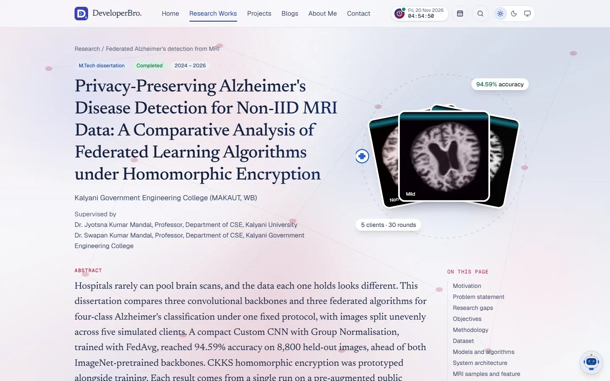
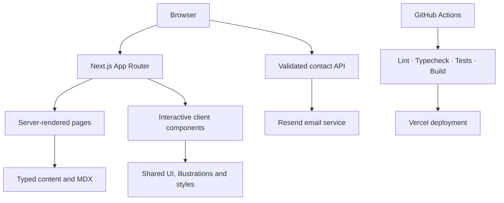

<!-- DeveloperBro. | Project documentation -->

<div align="center">

<a href="https://developerbro.vercel.app">
  
</a>

# DeveloperBro.

### 🎓 A Research-Driven Academic & Developer Portfolio

<p>
  <a href="https://developerbro.vercel.app">
    
  </a>
  <a href="https://github.com/Supriyo016/DeveloperBro-Academic-Portfolio">
    
  </a>
</p>

<p>
  
  
  
  
  
  
</p>

**Explore research. Understand the engineering. Discover the ideas behind every project.**

</div>

---

## 🌐 1. Project Overview

**DeveloperBro.** is a research-focused academic portfolio created to present academic work, technical projects, professional interests and research writing through one consistent digital experience.

The project focuses on three goals:

- 🎓 **Present academic work** — communicate research interests, methodology, technical contributions and project outcomes.
- 🧩 **Explain implementation** — make software work, engineering choices and supporting technologies easier to understand.
- ✍️ **Share knowledge** — publish technical notes with equations, code examples, diagrams and references.

The website is built with a responsive interface, accessible interactions and a maintainable **Next.js App Router** architecture. This README explains its features, implementation, local setup and development workflow.

| 🔎 Resource | 🔗 Destination |
|---|---|
| 🌐 Live portfolio | [developerbro.vercel.app](https://developerbro.vercel.app) |
| 💻 Source repository | [GitHub · DeveloperBro-Academic-Portfolio](https://github.com/Supriyo016/DeveloperBro-Academic-Portfolio) |
| ☁️ Hosting platform | Vercel |
| 🌿 Default branch | `main` |

## 🖥️ 2. Interface Preview

<div align="center">
  
  <br>
  <sub>Responsive homepage · Light theme</sub>
</div>

## ✨ 3. Core Features

The main experience is organised around clarity, responsive behaviour and focused interaction.

DeveloperBro. is designed to make academic and technical content easy to navigate without sacrificing visual detail.

| ✨ Feature | 📝 What it provides |
|---|---|
| 📱 Responsive layouts | Interfaces adapted for desktop, tablet and mobile screens |
| 🌗 Theme controls | Light and dark appearance with theme-aware components |
| 🎨 Custom visual system | SVG illustrations, icons and reusable UI elements |
| 🎞️ Motion and interaction | CSS-led animation with reduced-motion support and focused client-side behaviour |
| 🧭 Clear navigation | Structured routes, consistent page layouts and intuitive content hierarchy |
| 📚 Rich content | Typed content and MDX-based pages for technical writing |
| ✉️ Contact form | Validated form input with server-side email handling |
| ♿ Accessibility | Semantic structure, keyboard-conscious interactions and motion preferences |
| 🔎 Search discoverability | Metadata, sitemap, robots rules and structured profile information |

## 📸 4. Selected Screenshots

<div align="center">
  
  <br>
  <sub>Interior page · Responsive content layout</sub>
  <br><br>
  
  <br>
  <sub>Mobile interface</sub>
</div>

## 🧰 5. Technology and Tools

<div align="center">


</div>

The stack is selected to support a fast, accessible, research-focused portfolio, with strong typing, structured content, readable technical articles and reliable delivery.

### Core application stack

| Area | Technology | Role in DeveloperBro |
|---|---|---|
| Application framework | **Next.js 16** | App Router, server rendering, routing, metadata and API endpoints |
| UI library | **React 19** | Reusable interface components and interactive client-side features |
| Language | **TypeScript 6** | Typed application logic and safer component contracts |
| Styling | **Tailwind CSS 4** | Utility-first styling, responsive layouts and design consistency |
| Content | **MDX**, `next-mdx-remote`, `gray-matter` | Structured research notes and content pages |
| Markdown extensions | `remark-gfm`, `remark-math`, `rehype-slug` | Tables, task lists, mathematical notation and heading anchors |
| Mathematics | **KaTeX**, `rehype-katex` | Rendering inline and display equations |
| Code highlighting | **Shiki**, `rehype-pretty-code` | Syntax-highlighted code examples in technical articles |
| Validation | **Zod** | Runtime validation of contact-form input and structured data |
| Email delivery | **Resend** | Contact-form message delivery |
| Icons | **Lucide React** | Consistent interface icons |

### Development, testing and delivery

| Purpose | Technology | How it is used |
|---|---|---|
| Package management | **npm** | Dependency installation and project scripts |
| Linting | **ESLint 9** | Code-quality and lint checks |
| Static type checking | **TypeScript compiler** | `tsc --noEmit` validation |
| Unit and integration tests | **Vitest 5** | Automated application and utility tests |
| Browser automation | **Playwright** | End-to-end browser tests |
| Accessibility checks | **axe-core + Playwright** | Automated accessibility assertions in browser tests |
| CI | **GitHub Actions** | Automated quality checks on repository changes |
| Deployment | **Vercel** | Production hosting and Next.js deployment |
| Version control | **Git and GitHub** | Source history, collaboration and issue tracking |

### Supporting platform capabilities

- **RSS:** exposes the research notes feed for readers and feed aggregators.
- **Search and metadata:** uses generated page metadata, sitemap and robots rules to support discovery.
- **Responsive imagery:** Next.js image optimisation outputs modern AVIF and WebP formats where supported.
- **Contact configuration:** environment variables keep the Resend key, recipient address and optional signing secret outside source control.

> [!NOTE]
> This project does **not** currently use a database, authentication provider, Redux, a dedicated animation framework or a separate backend service. The website is implemented with Next.js and its API route for the contact workflow. The technology list above reflects the repository's current `package.json` and configuration rather than a generic skills list.

## 🏛️ 6. Application Architecture

<!-- DeveloperBro. | Project documentation -->

<div align="center">

<a href="https://developerbro.vercel.app">
  
</a>

# DeveloperBro.

### 🎓 A Research-Driven Academic & Developer Portfolio

<p>
  <a href="https://developerbro.vercel.app">
    
  </a>
  <a href="https://github.com/Supriyo016/DeveloperBro-Academic-Portfolio">
    
  </a>
</p>

<p>
  
  
  
  
  
  
</p>

**Explore research. Understand the engineering. Discover the ideas behind every project.**

</div>

---

## 🌐 1. Project Overview

**DeveloperBro.** is a research-focused academic portfolio created to present academic work, technical projects, professional interests and research writing through one consistent digital experience.

The project focuses on three goals:

- 🎓 **Present academic work** — communicate research interests, methodology, technical contributions and project outcomes.
- 🧩 **Explain implementation** — make software work, engineering choices and supporting technologies easier to understand.
- ✍️ **Share knowledge** — publish technical notes with equations, code examples, diagrams and references.

The website is built with a responsive interface, accessible interactions and a maintainable **Next.js App Router** architecture. This README explains its features, implementation, local setup and development workflow.

| 🔎 Resource | 🔗 Destination |
|---|---|
| 🌐 Live portfolio | [developerbro.vercel.app](https://developerbro.vercel.app) |
| 💻 Source repository | [GitHub · DeveloperBro-Academic-Portfolio](https://github.com/Supriyo016/DeveloperBro-Academic-Portfolio) |
| ☁️ Hosting platform | Vercel |
| 🌿 Default branch | `main` |

## 🖥️ 2. Interface Preview

<div align="center">
  
  <br>
  <sub>Responsive homepage · Light theme</sub>
</div>

## ✨ 3. Core Features

The main experience is organised around clarity, responsive behaviour and focused interaction.

DeveloperBro. is designed to make academic and technical content easy to navigate without sacrificing visual detail.

| ✨ Feature | 📝 What it provides |
|---|---|
| 📱 Responsive layouts | Interfaces adapted for desktop, tablet and mobile screens |
| 🌗 Theme controls | Light and dark appearance with theme-aware components |
| 🎨 Custom visual system | SVG illustrations, icons and reusable UI elements |
| 🎞️ Motion and interaction | CSS-led animation with reduced-motion support and focused client-side behaviour |
| 🧭 Clear navigation | Structured routes, consistent page layouts and intuitive content hierarchy |
| 📚 Rich content | Typed content and MDX-based pages for technical writing |
| ✉️ Contact form | Validated form input with server-side email handling |
| ♿ Accessibility | Semantic structure, keyboard-conscious interactions and motion preferences |
| 🔎 Search discoverability | Metadata, sitemap, robots rules and structured profile information |

## 📸 4. Selected Screenshots

<div align="center">
  
  <br>
  <sub>Interior page · Responsive content layout</sub>
  <br><br>
  
  <br>
  <sub>Mobile interface</sub>
</div>

## 🧰 5. Technology Stack

The technology choices prioritise **type safety, maintainable components, efficient rendering and a strong writing experience**.

### ⚙️ Core Application Technologies

| Layer | Technology |
|---|---|
| Framework | Next.js 16 |
| UI library | React 19 |
| Language | TypeScript |
| Styling | Tailwind CSS 4 and CSS variables |
| Content rendering | MDX |
| Mathematical typesetting | KaTeX |
| Code presentation | Shiki / rehype-pretty-code |
| Validation | Zod |
| Email delivery | Resend |
| Icons | Lucide React |

### 🧪 Development, Testing & Deployment

| Purpose | Tool |
|---|---|
| Linting | ESLint |
| Static checks | TypeScript |
| Unit and integration tests | Vitest |
| Browser testing | Playwright |
| Accessibility testing | axe-core with Playwright |
| CI | GitHub Actions |
| Hosting | Vercel |

## 🏛️ 6. Application Architecture

The application follows a **server-first rendering model** using the Next.js App Router. Server Components handle the majority of page rendering, while Client Components are introduced only for interactions that require browser state or APIs. The contact endpoint validates submitted data before forwarding messages to Resend.



### 💡 Key Engineering Decisions

- **Server-first rendering:** keep the client bundle focused and use server rendering for pages.
- **No database:** the current site does not require persistent visitor-generated content.
- **CSS-led motion:** use CSS transitions and a small amount of browser-side logic instead of a heavy animation runtime.
- **Theme-aware SVG:** reuse vector illustrations across themes through design tokens.
- **Validation at boundaries:** validate contact-form input before sending it to the email service.
- **Security-conscious delivery:** use request-level security headers and a restrictive Content Security Policy.
- **Reduced-motion support:** respect the user's operating-system motion preference.

For a deeper technical description, see [Architecture](docs/ARCHITECTURE.md).

## 🗂️ 7. Repository Structure

```text
DeveloperBro-Academic-Portfolio/
│
├── .github/
│   └── workflows/
│       └── ci.yml
│
├── docs/
│   ├── screenshots/
│   ├── ARCHITECTURE.md
│   ├── CONTENT_SOURCES.md
│   ├── DEPLOYMENT.md
│   ├── DEVELOPMENT_GUIDE.md
│   ├── SECURITY.md
│   └── TESTING.md
│
├── public/
├── scripts/
├── src/
│   ├── app/
│   ├── components/
│   ├── content/
│   ├── hooks/
│   ├── lib/
│   ├── services/
│   ├── types/
│   └── proxy.ts
│
├── tests/
├── .env.example
├── package.json
├── next.config.ts
├── playwright.config.ts
├── tsconfig.json
└── README.md
```

## 🚀 8. Getting Started

Run the following commands to set up the application on your machine.

### 📋 Prerequisites

- Node.js **20.9 or later**
- npm
- Git

### 📦 Installation & Local Setup

```bash
git clone https://github.com/Supriyo016/DeveloperBro-Academic-Portfolio.git
cd DeveloperBro-Academic-Portfolio
npm install
```

Install the Playwright Chromium browser for end-to-end testing:

```bash
npx playwright install chromium
```

Create a local environment file:

```bash
cp .env.example .env.local
```

Start the development server:

```bash
npm run dev
```

Open [http://localhost:3000](http://localhost:3000).

### 🛠️ Available Development Scripts

| Command | Description |
|---|---|
| `npm run dev` | Start the local development server |
| `npm run build` | Create a production build |
| `npm run start` | Run the production server |
| `npm run lint` | Run ESLint |
| `npm run typecheck` | Run TypeScript validation |
| `npm test` | Run Vitest tests |
| `npm run test:e2e` | Run Playwright browser tests |
| `npm run audit:deps` | Audit production dependencies |

### ✅ Run Quality Checks

Before opening a pull request, run the project's main quality checks:

```bash
npm run lint
npm run typecheck
npm test
npm run build
npm run test:e2e
```

## 🔐 9. Environment Configuration

The application uses environment variables for the canonical site URL and contact-form email delivery. Copy `.env.example` to `.env.local`, then configure only the values required for your local setup.

| Variable | Purpose |
|---|---|
| `NEXT_PUBLIC_SITE_URL` | Canonical website URL and sitemap generation |
| `RESEND_API_KEY` | API key for contact-form email delivery |
| `CONTACT_TO_EMAIL` | Destination address for contact messages |
| `CONTACT_FROM_EMAIL` | Verified sender address for email delivery |
| `GITHUB_TOKEN` | Optional token for GitHub API requests with higher rate limits |

Keep credentials in local environment files or the deployment provider's secret settings. Do not commit real keys or private environment values.

See [`.env.example`](.env.example) for the current variable template and [Deployment](docs/DEPLOYMENT.md) for deployment-specific notes.

## ☁️ 10. Deployment

🚀 The production deployment is hosted on **Vercel**:

[https://developerbro.vercel.app](https://developerbro.vercel.app)

The repository is connected to the Vercel project. Pushes to `main` are used for production deployments, while other branches can be used for previews.

For deployment configuration and post-deployment checks, see [docs/DEPLOYMENT.md](docs/DEPLOYMENT.md).

## 🔄 11. Continuous Integration

GitHub Actions runs the repository verification workflow for pushes and pull requests. It provides an automated quality gate before changes move towards deployment.

The workflow includes:

1. Install dependencies with `npm ci`.
2. Audit production dependencies.
3. Run TypeScript checks.
4. Run ESLint.
5. Execute the test suite.
6. Create a production build.

[View GitHub Actions](https://github.com/Supriyo016/DeveloperBro-Academic-Portfolio/actions)

## 📚 12. Documentation

| Document | Description |
|---|---|
| [Architecture](docs/ARCHITECTURE.md) | Application structure and engineering decisions |
| [Development guide](docs/DEVELOPMENT_GUIDE.md) | Local setup and development workflow |
| [Deployment](docs/DEPLOYMENT.md) | Hosting and environment configuration |
| [Testing](docs/TESTING.md) | Test strategy and execution |
| [Security](docs/SECURITY.md) | Security controls and known considerations |
| [Content sources](docs/CONTENT_SOURCES.md) | Content-source documentation |

## 🤝 13. Contributing

Contributions, bug reports, accessibility feedback and technical suggestions are welcome. Keep each change focused, explain the motivation and include screenshots when a change affects the interface.

1. 🍴 Fork this repository.
2. 🌿 Create a focused feature or fix branch.
3. 📦 Install dependencies and make the change.
4. ✅ Run the relevant lint, type, test and build checks.
5. 🔍 Review the result and add screenshots for visible UI changes.
6. 🚀 Open a pull request with a clear summary and testing notes.

Please avoid committing secrets, private files, generated build output or unrelated changes.

## 📄 14. Licence

See the repository's [LICENSE](LICENSE) file for licensing terms.

## 🔗 15. Project Links & Credits

<div align="center">

<a href="https://developerbro.vercel.app">
  
</a>
<a href="https://github.com/Supriyo016/DeveloperBro-Academic-Portfolio">
  
</a>

<br>

<sub>Project maintainer: <a href="https://github.com/Supriyo016">Supriyo Sarkar</a></sub>

</div>

---

<div align="center">

**DeveloperBro. — Research • Design • Develop • Share**

<sub>Built for curious minds. Structured for discovery. Engineered with purpose.</sub>

<br><br>


</div>
