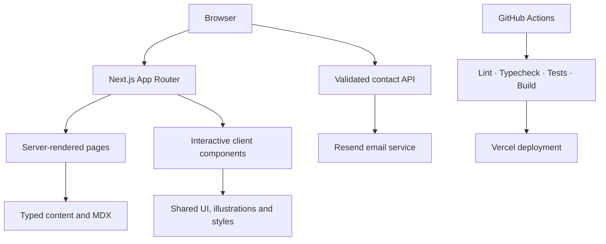

<!-- DeveloperBro. | Project documentation -->

<div align="center">

<a href="https://developerbro.vercel.app">
  
</a>

# DeveloperBro.

### A modern, responsive portfolio website

<p>
  <a href="https://developerbro.vercel.app">
    
  </a>
  <a href="https://github.com/Supriyo016/DeveloperBro-Academic-Portfolio">
    
  </a>
</p>

<p>
  
  
  
  
  
  
</p>

**A research-first digital portfolio for presenting academic work, technical projects and ideas with clarity.**

</div>

---

## 🌟 Overview

**DeveloperBro.** is a research-focused academic portfolio built to present academic background, research work, technical projects and writing in one organised place.

The website combines a responsive interface, accessible interactions and a maintainable Next.js architecture. The README describes the application and the way to run, test and contribute to it.

| 🌐 Project link | Details |
|---|---|
| **Live website** | [developerbro.vercel.app](https://developerbro.vercel.app) |
| **Source code** | [GitHub repository](https://github.com/Supriyo016/DeveloperBro-Academic-Portfolio) |
| **Hosting** | Vercel |
| **Default branch** | `main` |

## 🖼️ Interface preview

<div align="center">
  
  <br>
  <sub>Responsive homepage · Light theme</sub>
</div>

## ✨ Product highlights

The main experience is organised around clarity, responsive behaviour and focused interaction.

| Area | Implementation |
|---|---|
| Responsive interface | Layouts designed for desktop, tablet and mobile |
| Theme system | Light and dark appearance with theme-aware components |
| Visual design | Custom SVG illustrations, icons and reusable interface elements |
| Motion | CSS transitions and animation with reduced-motion support |
| Navigation | Structured routes, clear hierarchy and consistent page layouts |
| Interactive UI | Client-side components only where browser interaction is required |
| Content rendering | Typed content and MDX-based rendering |
| Contact experience | Validated contact form with server-side handling |
| Accessibility | Semantic structure, keyboard-aware interactions and motion preferences |
| Search visibility | Metadata, sitemap, robots rules and structured profile data |

## 📸 Screenshots

<div align="center">
  
  <br>
  <sub>Interior page · Responsive content layout</sub>
  <br><br>
  
  <br>
  <sub>Mobile interface</sub>
</div>

## 🧰 Technology stack

The stack is selected to keep the application type-safe, content-friendly and straightforward to maintain.

### ⚙️ Application

| Layer | Technology |
|---|---|
| Framework | Next.js 16 |
| UI library | React 19 |
| Language | TypeScript |
| Styling | Tailwind CSS 4 and CSS variables |
| Content rendering | MDX |
| Mathematical typesetting | KaTeX |
| Code presentation | Shiki / rehype-pretty-code |
| Validation | Zod |
| Email delivery | Resend |
| Icons | Lucide React |

### 🧪 Quality and delivery

| Purpose | Tool |
|---|---|
| Linting | ESLint |
| Static checks | TypeScript |
| Unit and integration tests | Vitest |
| Browser testing | Playwright |
| Accessibility testing | axe-core with Playwright |
| CI | GitHub Actions |
| Hosting | Vercel |

## 🏗️ Architecture

DeveloperBro. uses the Next.js App Router. Server Components are the default; Client Components are used only where browser interaction is required. This keeps most page rendering on the server while reserving client-side code for interactions that need it.



### 💡 Design and engineering decisions

- **Server-first rendering:** keep the client bundle focused and use server rendering for pages.
- **No database:** the current site does not require persistent visitor-generated content.
- **CSS-led motion:** use CSS transitions and a small amount of browser-side logic instead of a heavy animation runtime.
- **Theme-aware SVG:** reuse vector illustrations across themes through design tokens.
- **Validation at boundaries:** validate contact-form input before sending it to the email service.
- **Security-conscious delivery:** use request-level security headers and a restrictive Content Security Policy.
- **Reduced-motion support:** respect the user's operating-system motion preference.

For a deeper technical description, see [Architecture](docs/ARCHITECTURE.md).

## 🗂️ Repository structure

```text
DeveloperBro-Academic-Portfolio/
│
├── .github/
│   └── workflows/
│       └── ci.yml
│
├── docs/
│   ├── screenshots/
│   ├── ARCHITECTURE.md
│   ├── CONTENT_SOURCES.md
│   ├── DEPLOYMENT.md
│   ├── DEVELOPMENT_GUIDE.md
│   ├── SECURITY.md
│   └── TESTING.md
│
├── public/
├── scripts/
├── src/
│   ├── app/
│   ├── components/
│   ├── content/
│   ├── hooks/
│   ├── lib/
│   ├── services/
│   ├── types/
│   └── proxy.ts
│
├── tests/
├── .env.example
├── package.json
├── next.config.ts
├── playwright.config.ts
├── tsconfig.json
└── README.md
```

## 🚀 Getting started

Follow these steps to run the portfolio locally.

### 📋 Requirements

- Node.js **20.9 or later**
- npm
- Git

### 📦 Installation

```bash
git clone https://github.com/Supriyo016/DeveloperBro-Academic-Portfolio.git
cd DeveloperBro-Academic-Portfolio
npm install
```

Install the Playwright Chromium browser for end-to-end testing:

```bash
npx playwright install chromium
```

Create a local environment file:

```bash
cp .env.example .env.local
```

Start the development server:

```bash
npm run dev
```

Open [http://localhost:3000](http://localhost:3000).

### 🛠️ Available scripts

| Command | Description |
|---|---|
| `npm run dev` | Start the local development server |
| `npm run build` | Create a production build |
| `npm run start` | Run the production server |
| `npm run lint` | Run ESLint |
| `npm run typecheck` | Run TypeScript validation |
| `npm test` | Run Vitest tests |
| `npm run test:e2e` | Run Playwright browser tests |
| `npm run audit:deps` | Audit production dependencies |

### ✅ Quality checks

Run the main checks before submitting changes:

```bash
npm run lint
npm run typecheck
npm test
npm run build
npm run test:e2e
```

## 🔐 Environment configuration

The application reads optional contact and site configuration from environment variables. Copy `.env.example` to `.env.local` and configure the values needed for your local environment.

| Variable | Purpose |
|---|---|
| `NEXT_PUBLIC_SITE_URL` | Canonical website URL and sitemap generation |
| `RESEND_API_KEY` | API key for contact-form email delivery |
| `CONTACT_TO_EMAIL` | Destination address for contact messages |
| `CONTACT_FROM_EMAIL` | Verified sender address for email delivery |
| `GITHUB_TOKEN` | Optional token for GitHub API requests with higher rate limits |

Keep credentials in local environment files or the deployment provider's secret settings. Do not commit real keys or private environment values.

See [`.env.example`](.env.example) for the current variable template and [Deployment](docs/DEPLOYMENT.md) for deployment-specific notes.

## ☁️ Deployment

The production website is hosted on **Vercel**:

[https://developerbro.vercel.app](https://developerbro.vercel.app)

The repository is connected to the Vercel project. Pushes to `main` are used for production deployments, while other branches can be used for previews.

For deployment configuration and post-deployment checks, see [docs/DEPLOYMENT.md](docs/DEPLOYMENT.md).

## 🔄 Continuous integration

GitHub Actions runs the repository verification workflow on pushes and pull requests. The checks help catch common issues before deployment.

The workflow includes:

1. Install dependencies with `npm ci`.
2. Audit production dependencies.
3. Run TypeScript checks.
4. Run ESLint.
5. Execute the test suite.
6. Create a production build.

[View GitHub Actions](https://github.com/Supriyo016/DeveloperBro-Academic-Portfolio/actions)

## 📚 Project documentation

| Document | Description |
|---|---|
| [Architecture](docs/ARCHITECTURE.md) | Application structure and engineering decisions |
| [Development guide](docs/DEVELOPMENT_GUIDE.md) | Local setup and development workflow |
| [Deployment](docs/DEPLOYMENT.md) | Hosting and environment configuration |
| [Testing](docs/TESTING.md) | Test strategy and execution |
| [Security](docs/SECURITY.md) | Security controls and known considerations |
| [Content sources](docs/CONTENT_SOURCES.md) | Content-source documentation |

## 🤝 Contributing

Suggestions, bug reports and improvements are welcome. Please keep proposed changes focused, explain the reason for the change and include evidence for visible UI updates.

1. Fork the repository.
2. Create a focused branch for your change.
3. Install dependencies and run the relevant checks.
4. Keep changes consistent with the existing architecture and design system.
5. Submit a pull request with a clear description and screenshots for visible UI changes.

Please avoid committing secrets, private files, generated build output or unrelated changes.

## 📄 Licence

See the repository's [LICENSE](LICENSE) file for licensing terms.

## 🔗 Project links

<div align="center">

<a href="https://developerbro.vercel.app">
  
</a>
<a href="https://github.com/Supriyo016/DeveloperBro-Academic-Portfolio">
  
</a>

<br>

<sub>Project maintainer: <a href="https://github.com/Supriyo016">Supriyo Sarkar</a></sub>

</div>

---

<div align="center">

**DeveloperBro. — Design • Develop • Deploy**

<sub>Built with care. Designed for clarity. Engineered for the web.</sub>

<br><br>


</div>
