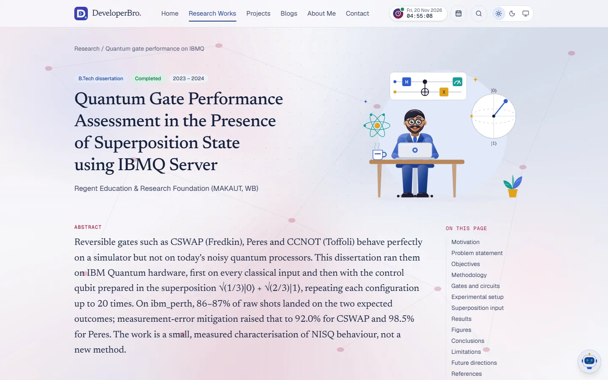
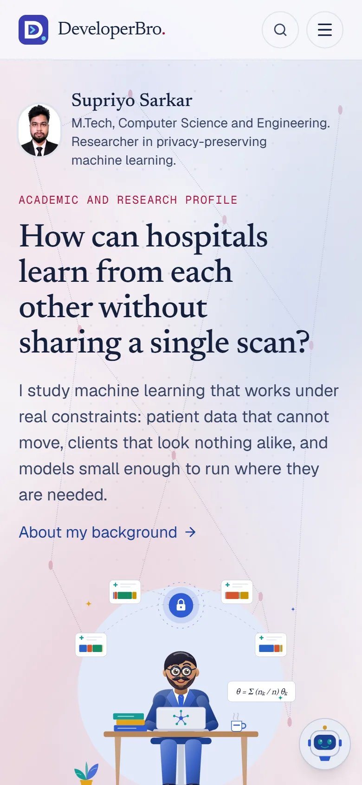

# DeveloperBro.

**The academic portfolio of Supriyo Sarkar**

Live at **[developerbro.vercel.app](https://developerbro.vercel.app)**

DeveloperBro. is my personal research portfolio. I am an M.Tech graduate in Computer Science and Engineering, and my
work is on privacy-preserving and federated machine learning for medical imaging. The website brings together my
research, projects, writing and academic background in one place, for anyone considering me for doctoral study or
research collaboration.

## Screenshots

| | |
| --- | --- |
|  |  |
| **Home, dark theme** | **Research Works** |
|  |  |
| **M.Tech case study** | **Inside the Custom CNN** |
|  |  |
| **Results explorer** | **Quantum case study** |
|  |  |
| **Blogs** | **About Me** |

   
  <b>On a phone</b>

## What you will find

- **Home**: who I am, what I am working on now, and a slideshow of my research themes.
- **Research Works**: my M.Tech dissertation on federated Alzheimer's detection from MRI, my ongoing work on knowledge
  distillation for encrypted federated learning, and my B.Tech dissertation on quantum gates on IBM Quantum hardware.
  Each has its own case study with interactive results, architecture diagrams, figures and references.
- **Projects**: Third Hand-Eye, an Arduino aid for visually impaired people; Tour India, a travel website from Smart
  India Hackathon 2022; and this portfolio.
- **Blogs**: research notes on federated learning, homomorphic encryption, deep learning and evaluation, with maths,
  code, charts and diagrams.
- **About Me**: education, skills, courses and certifications, achievements and research goals.
- **CV**: a web version and the PDF to download.
- **Contact**: a form for sending me a message, and my email and social links.

## Features

- Interactive research visualisations: model explorers, comparison charts, network diagrams and circuit diagrams
- Animated illustrations and a short animated story on the Research Works page
- Bro, a built-in chat assistant that answers questions about my work
- Light and dark themes, a live clock and calendar, and smooth page transitions
- Search across research, projects and blog posts
- Accessible by design, with a switch to pause all animation
- No tracking or advertising cookies

## Built with

Next.js, React, TypeScript and Tailwind CSS, hosted on Vercel.

## License

Copyright © 2026 Supriyo Sarkar. All rights reserved. See [LICENSE](LICENSE).

## Contact

Supriyo Sarkar · [supriyo.sarkar016@gmail.com](mailto:supriyo.sarkar016@gmail.com) ·
[LinkedIn](https://www.linkedin.com/in/supriyo-sarkar/) · [GitHub](https://github.com/Supriyo016)
